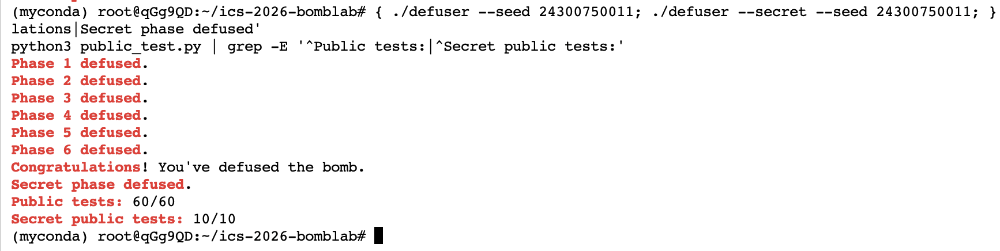

# Lab2 BombLab 实验报告

学号：24300750011

## 实验环境

- Ubuntu 22.04，x86-64
- GCC 11.4.0
- GNU GDB 12.1
- GNU Make 4.3
- Python 3.10.12
- GNU Binutils 2.38

## 测试结果

公开测试结果：Phase 1–6 为 60/60，Secret 为 10/10。

使用公开列表之外的 seed 进行了完整验证：

| seed | Phase 1–6 | Secret |
| --- | --- | --- |
| 24300750011 | 全部通过 | 通过 |
| 314159265 | 全部通过 | 通过 |
| 20261105 | 全部通过 | 通过 |



## Phase 1

### 关键汇编

```asm
shr rax, 0x20
shr rdx, 0x10
lea eax, [rdi+rdi*4]
add esi, 0x84da
xor eax, esi
lea eax, [rdi+rsi*2]
xor eax, 0xe6c4
lea eax, [rsi+0xcb3b]
xor eax, edi
```

### 计算关系与推理

`challenge` 被拆成低 32 位、右移 16 位后的低 32 位以及高 32 位三个部分，分别记作 `lo`、`mid`、`hi`。计算关系为：

```text
s2 = (hi * 5) XOR (lo + 0x84da)
s0 = (lo + mid * 2) XOR 0xe6c4
answer = (s2 + 0xcb3b) XOR s0
```

程序先通过 `step2`、`step0` 分别得到两个中间值，再由 `step1` 将它们组合成最终输出。底层汇编的移位、异或和加法均使用 32 位寄存器，因此采用 `uint32_t`，使溢出和截断行为与硬件一致。

## Phase 2

### 关键汇编

```asm
shr rax, 0x2a
and eax, 0x1f
mov ecx, 0xf
shr rax, cl
and eax, 0x3f
add eax, esi
xor eax, edx
add rdx, 0x1
add ecx, 0x5
```

### 计算关系与推理

第一个数通过将 `challenge` 右移 42 位并与 `0x1f` 按位与得到。后五项依次使用 15、20、25、30、35 五个移位位置，每次取 6 位后与前一项相加，再与当前下标异或：

```text
values[0] = (challenge >> 42) & 0x1f
values[i] = (((challenge >> (15 + 5 * (i - 1))) & 0x3f) + values[i - 1]) XOR i
```

汇编循环中的 `esi` 每轮都会被更新为当前输入，因此每一项依赖前一项形成递推，不能始终使用 `values[0]`。

## Phase 3

### 关键汇编

```asm
and edi, 0x7
shr rax, 0x3
shr rsi, 0x20
xor esi, eax
jmp QWORD PTR [rax*8+0x405820]
```

### 计算关系与推理

第一个输出同时也是跳转表索引，由 `challenge & 0x7` 得到。传入具体分支的参数为：

```text
param = (uint32_t)(challenge >> 3) XOR (uint32_t)(challenge >> 32)
```

函数指针跳转表没有按函数编号自然排列，不能直接认为索引 0 对应 `p3_case_0`。通过 GDB 检查 `0x405820` 处的八个目标地址，并与各个 case 的函数地址比较，恢复出以下映射：

| 索引 | 目标函数 |
| ---: | --- |
| 0 | `p3_case_7` |
| 1 | `p3_case_5` |
| 2 | `p3_case_2` |
| 3 | `p3_case_6` |
| 4 | `p3_case_0` |
| 5 | `p3_case_3` |
| 6 | `p3_case_1` |
| 7 | `p3_case_4` |

## Phase 4

### 关键汇编

```asm
sub edi, esi
shr edi, 1
add edi, esi
cmp edi, eax
lea esi, [rdi+0x1]
lea edx, [rdi-0x1]
lea eax, [rax+rax*4]
xor eax, ebx
xor eax, 0xc
xor eax, 0xf
```

### 计算关系与推理

搜索目标为 `challenge & 0x7f`，附加参数为 `(uint32_t)(challenge >> 7) XOR (uint32_t)(challenge >> 32)`。递归从区间 `[0, 127]` 开始，每次用 `lo + ((hi - lo) >> 1)` 计算中点；目标较小时进入左区间，较大时进入右区间。

命中目标时返回：

```text
(mid + 0xad) XOR c
```

递归返回时先将子结果乘以 5，再与 `mid + c` 异或。左分支最后异或 `0xc`，右分支最后异或 `0xf`，从而把搜索路径编码进最终结果。

## Phase 5

### 关键汇编

```asm
and eax, 0x7
mov rdx, QWORD PTR [rax*8+0x405b60]
shr rcx, 0x3
and edi, 0x3
mov rdx, QWORD PTR [rdx]
mov esi, DWORD PTR [rdx+0x8]
add eax, DWORD PTR [rdx+0xc]
lea eax, [rax+rax*4]
xor eax, esi
```

### 计算关系与推理

节点的 `next` 指针位于偏移 0，`value` 位于偏移 8，`salt` 位于偏移 12。程序使用 `challenge & 0x7` 从头指针表中选择起始节点，并使用 `(challenge >> 3) & 0x3` 决定继续沿 `next` 遍历的次数。

累计值首先由 challenge 的移位结果、高 32 位和常量 `0xe96c` 组合得到。每访问一个节点时执行：

```text
acc = ((acc + node.salt) * 5) XOR node.value
```

第一个输出是遍历结束后的累计值，第二个输出是最后访问节点的 `value`。由于 `defuser` 与 `bomb` 是不同进程，实现时将静态地址转换成数组下标，不能直接解引用 `bomb` 中的地址。

## Phase 6

### 关键汇编

```asm
shr rdi, 0x6
shr rax, 0x20
xor edi, eax
and ebx, 0x38
and eax, 0x7
call QWORD PTR [rax*8+0x405e00]
xor eax, 0x865c
call QWORD PTR [rbx+0x405e00]
add eax, 0x4694
```

### 计算关系与推理

第一次操作的输入值由 `challenge` 右移 6 位后的低 32 位与 challenge 的高 32 位异或得到。两次函数指针调用的索引分别取低 3 位和随后的 3 位：

```text
idx1 = low32(challenge) & 0x7
idx2 = (low32(challenge) >> 3) & 0x7
```

第一次操作完成后将结果与 `0x865c` 异或，再把结果交给第二次操作，最后加上 `0x4694`。函数指针数组没有按照 `op_0` 到 `op_5` 的自然顺序排列，因此需要读取 `0x405e00` 处的真实目标地址，恢复出的映射为：

```text
0→op_1, 1→op_3, 2→op_5, 3→op_3,
4→op_0, 5→op_5, 6→op_4, 7→op_2
```

## Secret / Honor

### 关键汇编

```asm
call strlen
sub rax, 0x24
cmp rax, 0x7f
cmp DWORD PTR [rbp-0xb0], 0x4e45504f
and ecx, 0x3
shr rsi, 0x20
xor esi, r12d
shr r8, 0x20
xor r8d, r13d
lea eax, [rdi+rdi*2+0xc14b]
xor eax, 0xb44
```

### 计算关系与推理

`secret_gate` 要求整行长度在 36 到 163 字节之间，偏移 32 处必须是 `OPEN`，从偏移 36 开始解析三个无符号十进制整数。第一个数字为 `context` 的低 2 位。

先分别将 challenge 和 context 的高低 32 位异或，得到 `a` 和 `b`。后续计算关系为：

```text
number1 = low32(context) & 3
mixed = (((a XOR b) * 3 + 0xc14b) XOR 0xb44)
extra = (number1 * 0xc14b) XOR low32(context >> 16)
number2 = mixed XOR extra
number3 = number2 XOR (b + number1 + 0xb44 + (a >> 5))
```

最终输出由 32 个 `A`、`OPEN` 标记及三个以空格分隔的数字组成：

```text
AAAAAAAAAAAAAAAAAAAAAAAAAAAAAAAAOPEN数字1 数字2 数字3
```

## 使用的资料与辅助工具

- 课程实验文档与模板仓库。
- `objdump`：提取个人 bomb 的函数反汇编和静态表数据。
- GDB：检查跳转表、函数指针表和链表节点布局。
- AI 辅助工具：用于解释汇编、检查本人写出的候选实现、运行编译与公开测试；最终关系需本人复核并能够说明。
